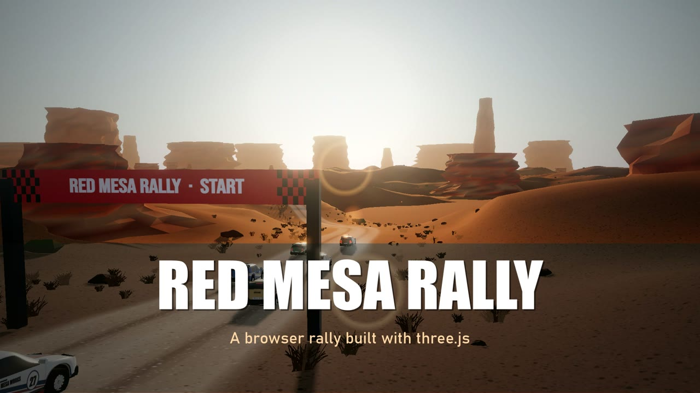
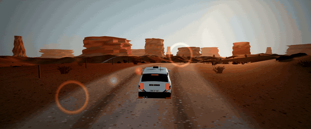
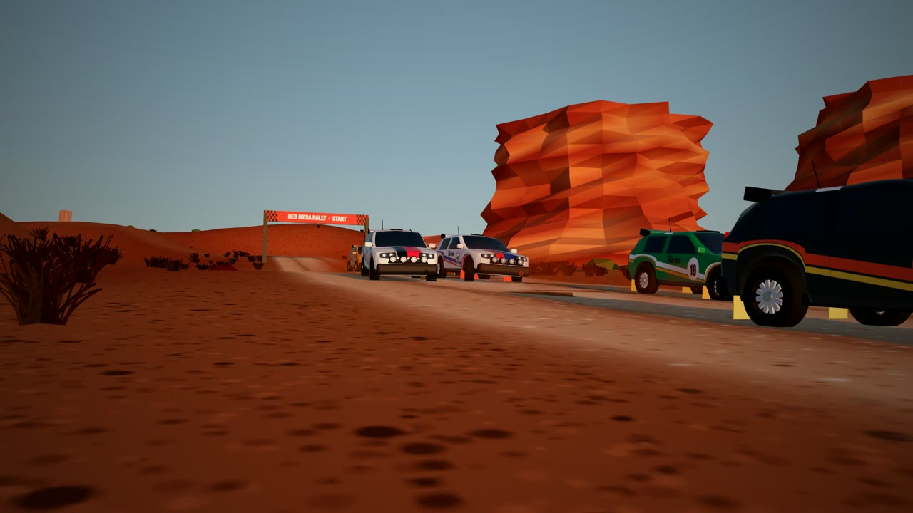
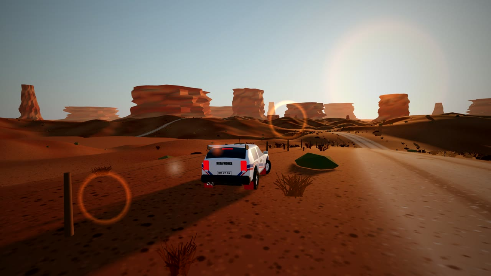
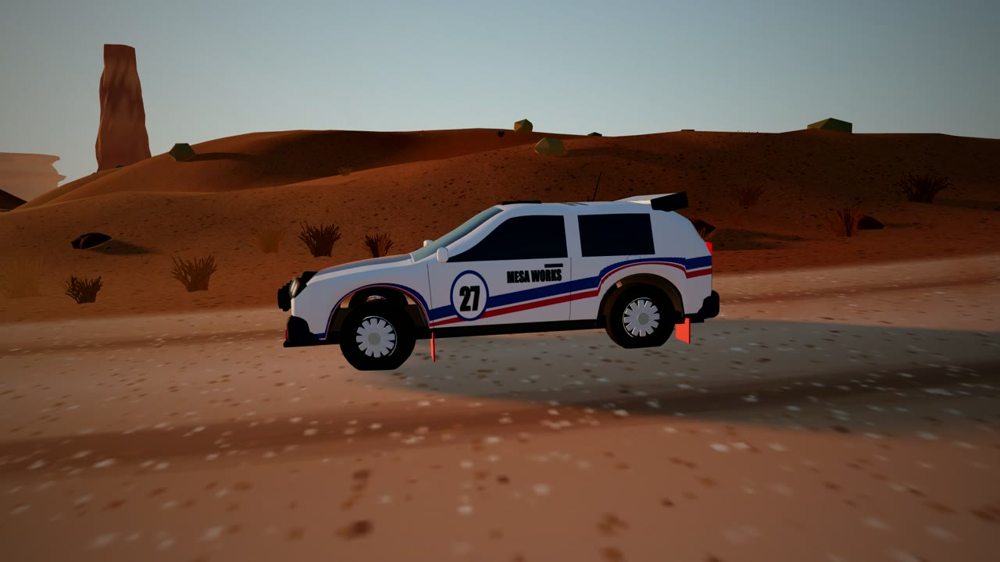
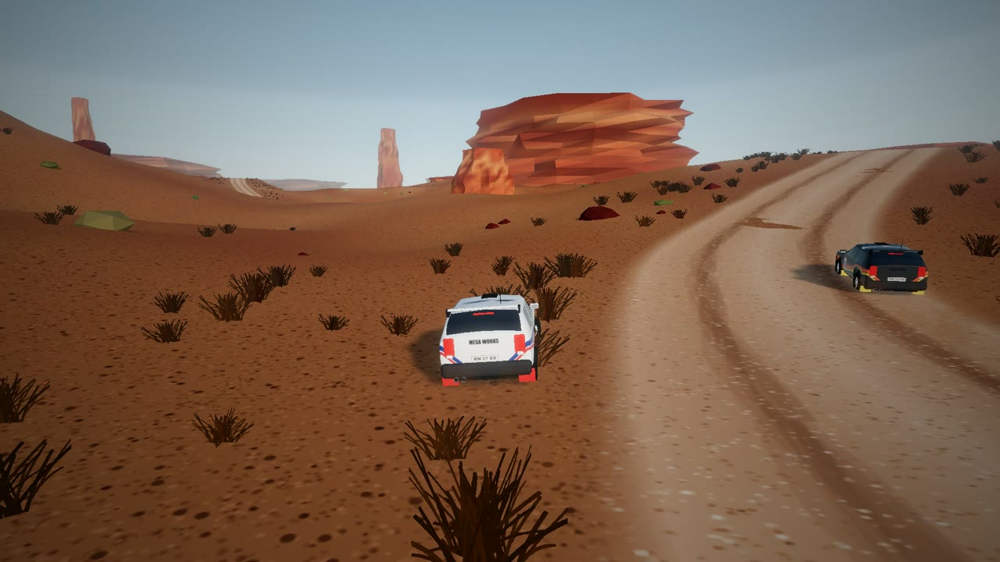
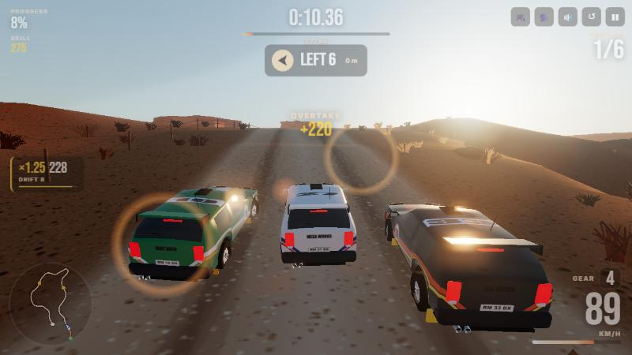

<div align="center">



# Red Mesa Rally

**Gravel, red rock and a low sun — a desert rally you play right in the browser.**

Procedural canyon stages · five AI rivals · skill chains · co-driver pace notes · no install, no build step

<p>
  <a href="https://jeiel85.github.io/red-mesa-rally/"></a>
  <a href="https://github.com/jeiel85/red-mesa-rally/releases/latest"></a>
</p>
<p>
  
  
  
  
</p>



</div>

---

## Gallery

| | |
|---|---|
|  |  |
|  |  |

<p align="center"></p>

## Features

- **Two special stages** — *Canyon Run* (afternoon, 2.6 km) and *Sundown Pass* (golden hour, 3.0 km), each grown from a seed: a winding gravel road carved into dunes, with mesas, spires and buttes on the horizon.
- **Race or Time Attack** — line up behind five AI rivals who take racing lines, brake for corners, dodge traffic and get shoved when you lean on them; or run the stage alone against your best time and splits.
- **Skill chain** — drifts, jumps, flat-out runs and overtakes stack a multiplier (up to ×5). Keep it alive and it banks as a *Skill Chain*, *Hot Streak* or *Legendary Streak*. Crash, trade paint too hard or leave the stage and it's gone.
- **Co-driver** — pace notes (`LEFT 4`, `HAIRPIN RIGHT`, `LONG`, `CAUTION`) are read from the road's curvature, shown ahead of every corner and spoken aloud with the browser's speech synthesis.
- **Rally feel** — a bicycle-model tyre simulation with weight transfer, handbrake turns, wheelspin, soft sand off the road, crests that throw you into the air, and a car that gets dustier the longer you drive.
- **Three cameras** — chase, bonnet and far chase. Lens flare, bloom, soft shadows and sun-lit dust plumes that never wall off your view.
- **Plays anywhere** — keyboard, gamepad, or on-screen touch controls on phones. Quality drops automatically on slow devices.

## Controls

| Action | Keyboard | Gamepad | Touch |
|---|---|---|---|
| Throttle / brake & reverse | `W` `S` or `↑` `↓` | RT / LT | **GAS** / **BRAKE** |
| Steer | `A` `D` or `←` `→` | Left stick | ◀ ▶ |
| Handbrake | `Space` | A / X | **HB** |
| Camera (chase · bonnet · far) | `C` | — | 🎥 |
| Back on the road | `R` | — | ↺ |
| Co-driver voice · mute · pause | `V` · `M` · `P` / `Esc` | — | 🗣️ 🔊 ❚❚ |

> **Tip:** brake in a straight line, flick the handbrake at the turn-in of hairpins and get back on the throttle early — a held drift through a long corner is worth more than a tidy one.

## How it's made

Everything you see and hear is generated at runtime — no models, textures or audio files.

| Piece | What happens | Code |
|---|---|---|
| Stage | A seeded random walk lays control points, a centripetal Catmull-Rom spline becomes the road, the heightfield is carved into a graded road bed, and corners become pace notes. | [`src/track.js`](src/track.js) |
| World | Vertex-coloured terrain, a ribbon road with rut texture, strata-banded rock formations, instanced boulders, shrubs, grass cards, fences and chevron boards. | [`src/world.js`](src/world.js) |
| Car | The shell is **lofted from cross-sections** (curved roof, tumblehome, real wheel-arch cut-outs) with glass and pillars split per face, and the livery is painted onto it through UVs. | [`src/carmodel.js`](src/carmodel.js) |
| Physics | Bicycle model with slip-angle tyre forces, load transfer, handbrake, slope gravity, airtime and obstacle collisions at 120 Hz. | [`src/car.js`](src/car.js) |
| Rivals | Corner-speed planning from road curvature, racing line, overtaking, light rubber-banding, contact with the player. | [`src/rivals.js`](src/rivals.js) |
| Skill chain | Drift / air / speed / overtake detection, multiplier, banking and breaking. | [`src/skills.js`](src/skills.js) |
| Look | three.js `Sky`, sky-based environment reflections, lens flare, Unreal bloom, ACES tone mapping, soft shadows that follow the car, custom dust shader. | [`src/main.js`](src/main.js), [`src/dust.js`](src/dust.js) |
| Sound | Web Audio engine (detuned saws through a waveshaper), gravel noise and impact thumps. | [`src/audio.js`](src/audio.js) |

## Run it locally

It's plain ES modules plus an import map, so any static server works:

```bash
git clone https://github.com/jeiel85/red-mesa-rally.git
cd red-mesa-rally
python -m http.server 5173
```

Then open <http://localhost:5173>. (Opening `index.html` straight from disk won't work — browsers block module imports over `file://`.)

## 한국어 소개

**Red Mesa Rally**는 붉은 사암 협곡을 달리는 브라우저 랠리 게임입니다. 설치 없이 링크만 열면 바로 플레이할 수 있어요.

- **스테이지 2종**: 오후의 *Canyon Run*, 노을 지는 *Sundown Pass* — 시드 기반으로 생성되는 비포장 도로와 메사·첨탑 지형
- **레이스 / 타임어택**: AI 라이벌 5대와 순위 경쟁, 또는 혼자 기록·구간 기록 도전
- **스킬 체인**: 드리프트·점프·고속 주행·추월로 배수(최대 ×5)를 쌓고, 충돌하거나 코스를 벗어나면 체인이 끊깁니다
- **코드라이버 페이스노트**: 코너 곡률을 읽어 `LEFT 4`, `HAIRPIN RIGHT` 같은 안내를 화면과 음성으로 알려줍니다
- **조작**: `WASD`/방향키 주행, `Space` 핸드브레이크, `C` 카메라 전환, `R` 도로 복귀 — 게임패드와 모바일 터치도 지원

모든 그래픽과 사운드는 실행 중에 코드로 생성하며 외부 에셋을 쓰지 않습니다.

## Credits

Built with [three.js](https://threejs.org/) (MIT). Fonts: Bebas Neue and Inter from Google Fonts.
Red Mesa Rally is an original game inspired by the mood of desert rally stages; it is not affiliated with any rally game, team or series. All team names, liveries and numbers are fictional.

## License

[MIT](LICENSE) © 2026 jeiel85
